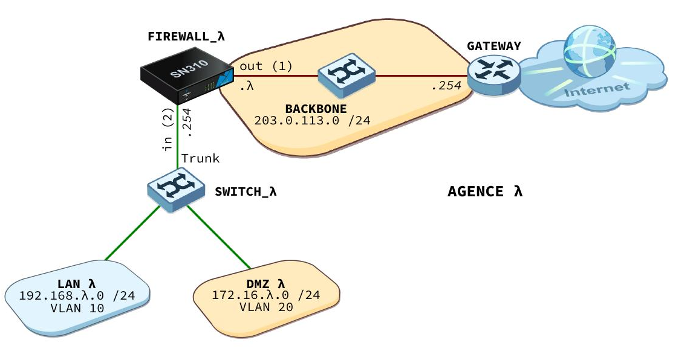

#  SAÉ 401 — Sécuriser un système d'information

> Projet de 2ᵉ année de BUT Réseaux & Télécommunications (parcours Cybersécurité) — IUT d'Auxerre.
> Déploiement **et** sécurisation d'un système d'information multi-site pour une agence fictive (« agence 4 »), en suivant les recommandations de l'**ANSSI**.

---

##  En résumé

L'objectif de ce projet est de construire une infrastructure réseau complète, puis de la **sécuriser de bout en bout** en adoptant la démarche d'un professionnel de la cybersécurité :

1. **Installer** et configurer l'ensemble de l'infrastructure (pare-feu, commutateur, serveurs).
2. **Attaquer** cette infrastructure (tests d'intrusion) pour révéler ses vulnérabilités.
3. **Sécuriser** en appliquant une contre-mesure pour chaque faille identifiée.
4. **Ré-attaquer** pour prouver que les protections sont efficaces.

Le rapport complet (52 pages, captures commentées et diagnostics) se trouve dans [`rapport/`](rapport/).

---

##  Architecture réseau



| Zone | Réseau | VLAN | Rôle |
|------|--------|------|------|
| **WAN** | `203.0.113.0/24` | — | Accès Internet via le Backbone |
| **LAN** | `192.168.4.0/24` | VLAN 10 | Postes utilisateurs |
| **DMZ** | `172.16.4.0/24` | VLAN 20 | Serveurs exposés |

**Équipements :**
- **Pare-feu** Stormshield SN320 — routage inter-zones, filtrage, NAT, relais DHCP
- **Commutateur** Cisco C1000 — VLAN, trunk 802.1Q, protections de couche 2
- **Serveur Windows Server 2022** — Active Directory, DNS, DHCP, LDAPS, NTP, profils itinérants
- **Serveur Linux (Debian)** — Web (Apache/HTTPS), messagerie (Postfix/Dovecot/SMTPS), FTPS, Syslog/Zabbix, SSH

---

##  Services déployés

### Serveur Windows Server 2022
- **Active Directory Domain Services** — domaine `agence4.fr`, unités d'organisation, comptes et groupes
- **DNS** — zones de recherche directe et inverse
- **DHCP** — étendue du réseau LAN
- **LDAPS** — chiffrement TLS des échanges avec l'annuaire (port 636)
- **NTP** — synchronisation horaire du domaine
- **Profils itinérants** — centralisation des données utilisateurs

### Serveur Linux (Debian)
- **SSH** — authentification par clé, port modifié, root interdit
- **Apache / HTTPS** — redirection automatique HTTP → HTTPS, certificat TLS
- **Messagerie** — Postfix (SMTPS), Dovecot (IMAP/POP3 chiffré), authentification SASL
- **FTPS** — transfert de fichiers chiffré obligatoire (vsftpd)
- **Supervision** — centralisation des journaux (Syslog) et Zabbix
- **PKI interne** — autorité de certification pour l'ensemble des services

---

##  Tests d'intrusion et sécurisation

La démarche appliquée est **avant → sécurisation → après** pour chaque attaque. Voici la synthèse :

| # | Attaque | Vulnérabilité | Contre-mesure (ANSSI) |
|---|---------|---------------|------------------------|
| 1 | Scan **Nikto** (Web) | En-têtes HTTP de sécurité absents | HSTS, CSP, X-Frame-Options, etc. |
| 2 | Énumération **LDAP** | Annuaire interrogeable en clair | Déploiement de **LDAPS** (TLS/636) |
| 3 | **AS-REP Roasting** | Compte sans pré-authentification Kerberos | Réactivation de la pré-authentification |
| 4 | **DHCP Rogue** | Faux serveur DHCP accepté | **DHCP Snooping** |
| 5 | **MAC Flooding** | Saturation de la table MAC | **Port Security** |
| 6 | **ARP Spoofing** | Man-in-the-Middle (usurpation ARP) | **Dynamic ARP Inspection** + signature SMB |
| 7 | Scan **Nmap** (Linux) | Ports inutiles exposés (HTTP, SMTP) | Fermeture des ports, HTTPS uniquement |
| 8 | Brute force **SSH** | Attaque par dictionnaire | Authentification par clé uniquement |
| 9 | Brute force **FTP** | Transfert en clair | **FTPS** imposé |
| 10 | Accès **root SSH** | Connexion directe au compte root | `PermitRootLogin no` |
| 11 | Chiffrement | Interception du trafic | TLS vérifié (HTTPS, FTPS) |
| 12 | Accès **SYSVOL** | Politique de mot de passe faible | Renforcement GPO + énumération anonyme désactivée |
| 13 | **SYN Flooding** | Déni de service (~338 Mbps) | **Storm Control** |

**Outils utilisés :** Nmap, Nikto, Hydra, Wireshark, macof, arpspoof, hping3, Impacket, John the Ripper, smbclient, ldapsearch (Kali Linux).

---

##  Planning du projet

Le projet a été mené sur 13 séances (environ 50 h), organisées selon la démarche installation → tests → sécurisation → ré-attaque.

Le diagramme de Gantt détaillé figure dans le rapport (chapitre 1).

---

##  Organisation du dépôt

```
SAE401-Securisation-SI/
├── README.md                ← vous êtes ici
├── rapport/
│   ├── Rapport_SAE401.pdf    ← le rapport complet (52 pages)
│   └── Rapport_SAE401.docx   ← version Word modifiable
├── sujet/
│   └── Sujet_SAE401.pdf      ← l'énoncé du projet
└── docs/
    └── images/               ← schéma réseau et illustrations
```

---

##  Compétences mises en œuvre

- Administration d'un **système d'information sécurisé** (Windows Server, Linux, Cisco, Stormshield)
- **Supervision** et centralisation des journaux (Syslog, Zabbix)
- Mise en œuvre d'**outils cryptographiques** (PKI, certificats, TLS, LDAPS, SSH par clé)
- **Tests d'intrusion** et durcissement selon les recommandations de l'**ANSSI**
- Sécurisation de **couche 2** (Port Security, DHCP Snooping, DAI, Storm Control)

---


<p align="center"><i>BUT Réseaux & Télécommunications — Parcours Cybersécurité — IUT d'Auxerre</i></p>
